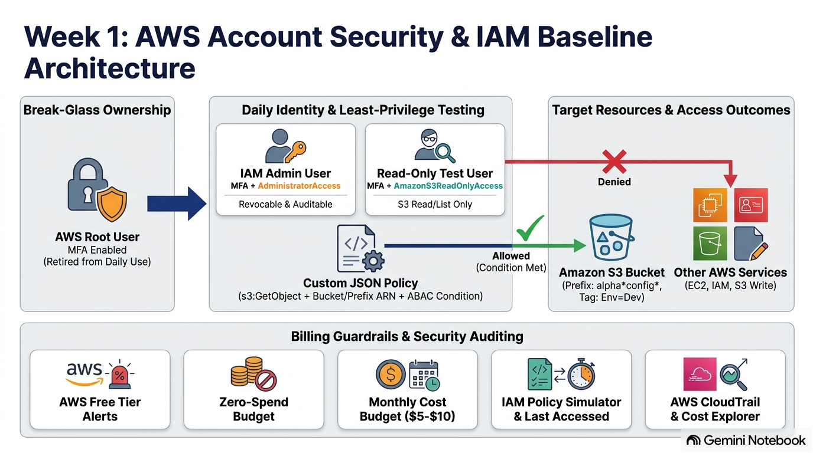
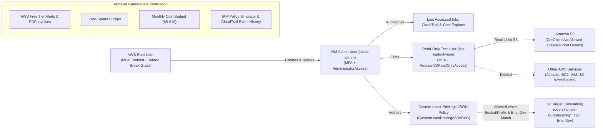
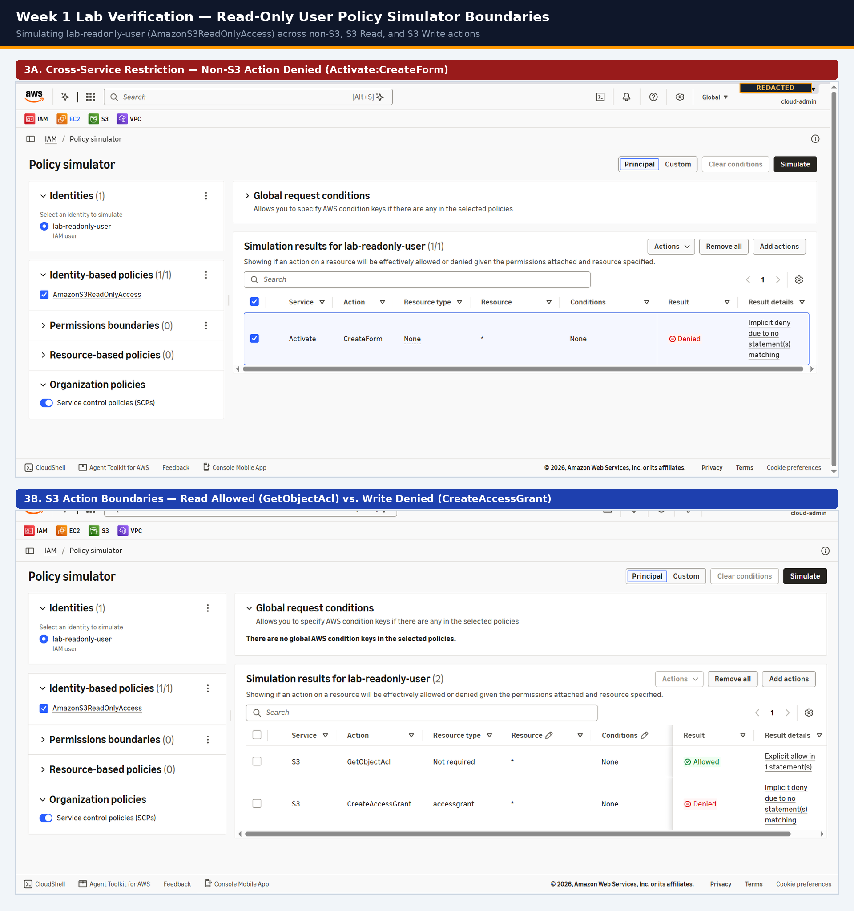

<div align="center">

# AWS Account Security, Billing Guardrails & IAM Least-Privilege Baseline


**Day-one AWS account hardening: Root MFA lockdown, `cloud-admin` daily IAM user, Zero-Spend billing guardrails, and custom ABAC least-privilege S3 policies.**

</div>

---

## 1. Architecture Overview



<details>
<summary><b>Click to expand Mermaid Architecture Diagram (Interactive Source)</b></summary>



</details>

> [!IMPORTANT]
> **Key Design Decision:** Retired the unrestricted AWS Root User immediately after enabling Authenticator App MFA, isolated daily administration to an MFA-protected IAM Admin (`cloud-admin`), and replaced wildcard `*` S3 permissions with a prefix + tag-scoped ABAC JSON policy (`CustomLeastPrivilegeS3ABAC`). *(Enterprise Note: AWS recommends IAM Identity Center for multi-account setups; a single IAM Admin user fits an individual learning account.)*

---

## 2. Problem & Solution

| Aspect | Detail |
| :--- | :--- |
| **Problem** | Operating an AWS account with the Root User, no billing tripwires, or broad wildcard IAM policies risks account compromise and unexpected charges. |
| **Solution** | Locked Root behind MFA, created `cloud-admin` with MFA, configured 3 billing guardrails (Free Tier Alerts, Zero-Spend Budget, `$5–$10` Monthly Budget), and authored `CustomLeastPrivilegeS3ABAC`. |
| **Security Boundary** | `CustomLeastPrivilegeS3ABAC` allows `s3:GetObject` only on `arn:aws:s3:::doc-example-bucket/config*` when `s3:ExistingObjectTag/Env = Dev`; `lab-readonly-user` isolation verified via IAM Policy Simulator, live Console denial, and CloudTrail. |

---

## 3. Tech Stack
- **Cloud & Identity:** AWS IAM, IAM Policy Simulator, Amazon S3 (policy scoping target & live Console test)
- **Auditing & Monitoring:** AWS CloudTrail Event History (`ConsoleLogin`, `CheckMfa`), IAM Last Accessed Information
- **Cost Governance:** AWS Billing & Cost Management (Free Tier Alerts, PDF Invoices, Zero-Spend Budget, Monthly Cost Budget `$5–$10`, Cost Explorer)

---

## 4. Implementation Steps (Summary)
1. **Day 1 — Root Lockdown & Billing Guardrails:** Enabled Authenticator App MFA on Root, created daily IAM Admin `cloud-admin` (`AdministratorAccess` + Virtual MFA), enabled Free Tier alerts + PDF invoices, and set Zero-Spend + `$5–$10` Monthly Cost Budgets.
2. **Days 2–3 — Custom Least-Privilege ABAC Policy:** Compared `AmazonS3ReadOnlyAccess` against a scoped customer-managed policy (`CustomLeastPrivilegeS3ABAC`) restricting `s3:GetObject` to `doc-example-bucket/config*` with `s3:ExistingObjectTag/Env = Dev`, and tested Allow/Deny in IAM Policy Simulator.
3. **Days 4–5 — Admin vs. Read-Only Isolation Lab:** Created `lab-readonly-user` (`AmazonS3ReadOnlyAccess` + Virtual MFA), verified `Explicit allow` (`GetObjectAcl`) vs. `Implicit deny` (`CreateAccessGrant`, `Activate:CreateForm`) in Policy Simulator, tested live `s3:CreateBucket` denial in Console, and audited via CloudTrail.
4. **Days 6–7 — Posture Audit & Cleanup:** Verified `$0.00` spend in Cost Explorer and deleted temporary `lab-readonly-user` while keeping permanent Root MFA, `cloud-admin`, and billing guardrails active.

<details>
<summary><b>Click to expand Custom JSON Policy, Error Log & Cleanup Checklist</b></summary>

```json
{
    "Version": "2012-10-17",
    "Statement": [
        {
            "Sid": "VisualEditor0",
            "Effect": "Allow",
            "Action": "s3:GetObject",
            "Resource": "arn:aws:s3:::doc-example-bucket/config*",
            "Condition": {
                "ForAnyValue:StringEquals": {
                    "s3:ExistingObjectTag/Env": "Dev"
                }
            }
        }
    ]
}
```

### Error Log & Lessons Learned

| Issue Encountered | Root Cause | Resolution |
| :--- | :--- | :--- |
| Visual Editor displayed `accesspointobject` and `"Specified object resource ARN for the AbortMultipartUpload and 43 more actions"` when only `s3:GetObject` was checked. | AWS IAM Console UI displays all S3 resource types associated with the service (`object` and `accesspointobject`) and lists other actions sharing that resource type. | Switched to the **JSON** editor tab to confirm only `"Action": "s3:GetObject"` was present, selected **Specific** ARN (`doc-example-bucket/config*`), and verified no stray `"*"` remained. |
| Newly created `lab-readonly-user` had zero access to any service initially. | All IAM principals start with zero implicit permissions until an identity-based policy is attached. | Attached `AmazonS3ReadOnlyAccess` to `lab-readonly-user` and enrolled Virtual MFA before testing. |
| Confusion between Console UI navigation errors and API permission failures when testing scoped policies. | The AWS Management Console often needs extra list/display permissions to render UI pages compared to direct API calls. | Validated `s3:GetObject` + ABAC tag logic in **IAM Policy Simulator**, verified live `s3:CreateBucket` denial in S3 Console, and inspected **CloudTrail Event History**. |

### Resource Cleanup Checklist
- [x] Signed out of `lab-readonly-user` and signed back in as `cloud-admin` + MFA.
- [x] Deleted temporary test user `lab-readonly-user` in **IAM → Users**.
- [x] Checked **Billing and Cost Management → Cost Explorer** (`$0.00` spend).
- [x] Retained permanent baseline: Root MFA, `cloud-admin` + MFA, Free Tier Alerts, Zero-Spend Budget, and Monthly Cost Budget.

</details>

---

## 5. Verification & Results
*(All AWS Account IDs and sensitive identifiers are redacted.)*

1. **IAM Users & Read-Only Permissions Baseline (`cloud-admin` & `lab-readonly-user`):**
   
2. **Custom Least-Privilege ABAC Policy (`CustomLeastPrivilegeS3ABAC`) & Simulator:**
   
3. **Read-Only Isolation in IAM Policy Simulator:**
   
4. **Live Console `AccessDenied` Test & CloudTrail Event History:**
   

*(Optional guardrails screenshot path if captured: `./screenshots/week1-05-root-mfa-and-budgets.png`)*

---

## 6. Key Engineering Takeaways
- **Defense-in-Depth from Day One:** Combining Root MFA, a revocable daily IAM Admin, and Zero-Spend Budgets prevents both security incidents and surprise bills.
- **Verify Policies in JSON & Simulator:** Always inspect the generated JSON tab and test both Allow and Implicit Deny paths in the IAM Policy Simulator before relying on a policy.
