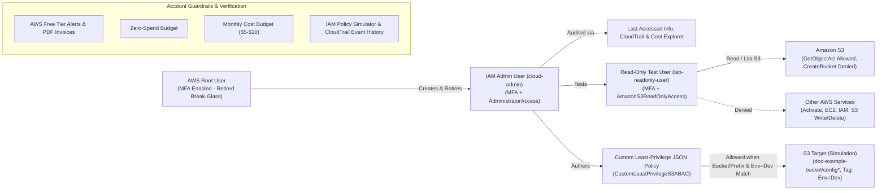
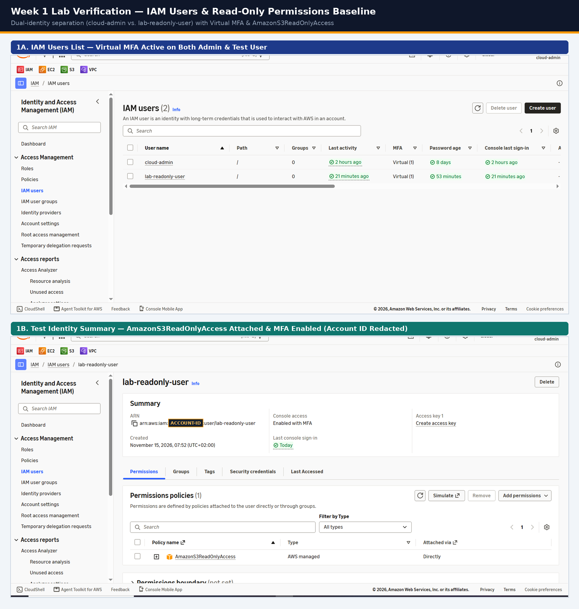
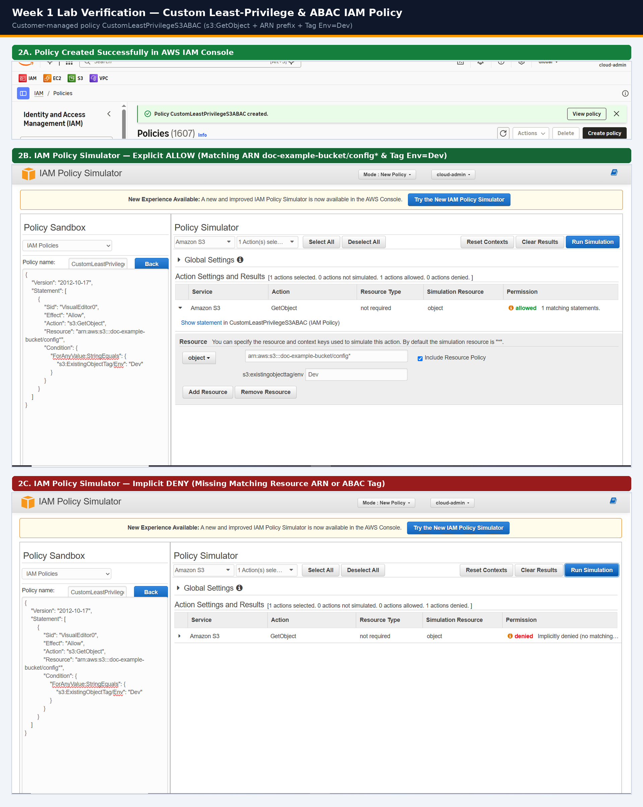
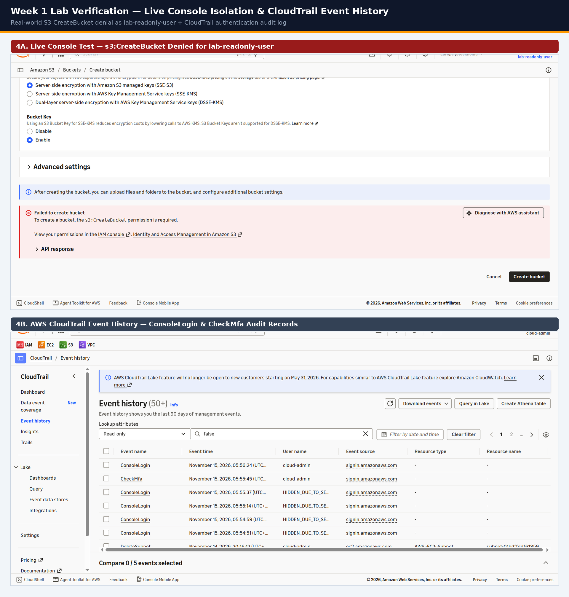

# Week 1: AWS Account Security, Billing Guardrails & IAM Least-Privilege Baseline

## 1. Project Overview
- **Goal:** Secure a new AWS account from day one by locking away the Root User with Multi-Factor Authentication (MFA), creating a daily IAM Admin user (`cloud-admin`) with MFA, configuring billing guardrails, authoring custom least-privilege IAM JSON policies with Attribute-Based Access Control (ABAC), and verifying access isolation using a simulated read-only user (`lab-readonly-user`).
- **AWS Services Used:** AWS Identity and Access Management (IAM), IAM Policy Simulator, AWS Billing and Cost Management (Free Tier Alerts, AWS Budgets, Cost Explorer), AWS CloudTrail, Amazon S3 (policy scoping target & live console test).
- **Roadmap Phase / Week:** Phase 1 — Week 1 (Foundations & CLF-C02 Sprint).

---

## 2. Architecture Diagram


<details>
<summary>Mermaid Architecture Diagram (Interactive Source)</summary>



</details>

---

## 3. Step-by-Step Implementation

### Day 1: Root Account Security & Billing Guardrails
1. **Root User Lockdown:** Enabled an Authenticator App MFA device on the AWS Root User and treated Root strictly as a break-glass identity for rare account-level tasks.
2. **Daily IAM Admin User (`cloud-admin`):** Created a dedicated IAM Admin user (`AdministratorAccess`) with Console access and an assigned Virtual MFA device, signed out of Root, and switched to `cloud-admin` (signing in via Account ID / Account Alias) for all daily operations.
3. **Billing Guardrails:**
   - Enabled **AWS Free Tier alerts** and **PDF invoices by email** under Billing Preferences.
   - Created a **Zero-Spend Budget** to trigger an email tripwire at the first cent of spend.
   - Created a **Monthly Cost Budget ($5–$10)** with actual and forecasted threshold alerts.

### Days 2–3: IAM Policy Structure & Custom Least-Privilege ABAC Policy
1. Studied IAM principals (Users, Groups, Roles), identity-based managed policies (AWS Managed vs. Customer Managed), and policy elements (`Effect`, `Action`, `Resource`, `Condition`).
2. Compared the broad `AmazonS3ReadOnlyAccess` managed policy (`s3:Get*`, `s3:List*`, `Resource: "*"`) against a narrowly scoped customer-managed policy built in the IAM Visual Editor and verified in JSON.
3. Created `CustomLeastPrivilegeS3ABAC` restricting `s3:GetObject` to a specific bucket/prefix ARN and enforcing an ABAC object-tag condition (`Env=Dev`) — using `doc-example-bucket/config*` as a simulation target prior to creating live S3 buckets in Week 2:

```json
{
    "Version": "2012-10-17",
    "Statement": [
        {
            "Sid": "VisualEditor0",
            "Effect": "Allow",
            "Action": "s3:GetObject",
            "Resource": "arn:aws:s3:::doc-example-bucket/config*",
            "Condition": {
                "ForAnyValue:StringEquals": {
                    "s3:ExistingObjectTag/Env": "Dev"
                }
            }
        }
    ]
}
```

4. Validated both **Allowed** (matching ARN `arn:aws:s3:::doc-example-bucket/config*` + `s3:existingobjecttag/env = Dev`) and **Implicitly Denied** (missing tag/resource match) outcomes in the **IAM Policy Simulator**.

### Days 4–5: IAM Security Baseline Lab (Admin vs. Read-Only Isolation)
1. Created a simulated read-only test user (`lab-readonly-user`) with Console access, attached `AmazonS3ReadOnlyAccess`, and secured it with Virtual MFA.
2. Validated boundaries in the **IAM Policy Simulator**: confirmed `Explicit allow` for S3 read (`GetObjectAcl`) and `Implicit deny` for S3 write (`CreateAccessGrant`) as well as unrelated services (`Activate:CreateForm`).
3. Signed in live as `lab-readonly-user` and attempted to create an S3 bucket, verifying the real-world Console denial (`Failed to create bucket: s3:CreateBucket permission is required`).
4. Switched back to `cloud-admin` and reviewed **AWS CloudTrail Event History** (`ConsoleLogin`, `CheckMfa`) alongside **Last Accessed Information** for ongoing permission auditing.

### Days 6–7: Security Posture Review, Error Log & Cleanup
1. Audited the account baseline (Root MFA active, `cloud-admin` active, Budgets active) and checked **AWS Cost Explorer** to confirm zero unexpected spend.
2. Deleted temporary lab test resources (`lab-readonly-user`) while preserving permanent account security and billing guardrails.

---

## 4. Security & Cost Optimization Trade-offs
- **Security Applied:**
  - Retired the unrestricted Root User from daily use; isolated everyday building to an MFA-protected IAM Admin user (`cloud-admin`) that is revocable, auditable, and deletable in seconds.
  - Replaced wildcard `*` resources and broad managed actions with explicit Action (`s3:GetObject`), specific ARN prefix scoping (`doc-example-bucket/config*`), and ABAC tag conditions (`s3:ExistingObjectTag/Env = Dev`).
  - *Enterprise Note:* AWS recommends **IAM Identity Center** for multi-account/organization setups; a single IAM Admin user is the pragmatic choice for an individual learning account.
- **Cost Controls:**
  - Zero-cost IAM identity and policy baseline combined with three proactive billing guardrails (Free Tier Alerts, Zero-Spend Budget, Monthly Cost Budget) and a weekly **Cost Explorer** inspection routine.

---

## 5. Verification & Screenshots (Security Redacted)

All AWS Account IDs and sensitive account identifiers have been redacted prior to publishing.

### Core Lab Evidence
1. **IAM Users & Read-Only Permissions Baseline (`cloud-admin` & `lab-readonly-user` with Virtual MFA + `AmazonS3ReadOnlyAccess`):**
   

2. **Custom Least-Privilege ABAC Policy (`CustomLeastPrivilegeS3ABAC` Creation + Policy Simulator Allow/Deny):**
   

3. **Read-Only Isolation in IAM Policy Simulator (Cross-Service Deny + S3 Read Allow vs. Write Deny):**
   

4. **Live Console `AccessDenied` Test & CloudTrail Event History:**
   

### Optional Account Guardrails Evidence (Add if captured)
- `./screenshots/week1-05-root-mfa-and-budgets.png` — IAM Dashboard Root MFA green status & Billing Budgets (`Zero-Spend` + `Monthly Cost`) + `Cost Explorer` `$0.00` verification.

---

## 6. Error Log & Lessons Learned

| Issue Encountered | Root Cause | Resolution |
| :--- | :--- | :--- |
| Visual Editor displayed `accesspointobject` and `"Specified object resource ARN for the AbortMultipartUpload and 43 more actions"` even when only `s3:GetObject` was checked. | Current AWS IAM Console UI displays all S3 resource types associated with the service (`object` and `accesspointobject`) and shows an informational label listing other actions that share the `object` resource type. | Switched to the **JSON** editor tab to confirm only `"Action": "s3:GetObject"` was present, selected **Specific** ARN for `object` (`doc-example-bucket/config*`), and verified no stray `"*"` or `accesspoint` ARNs remained. |
| Newly created `lab-readonly-user` had zero access to any service immediately after creation. | All IAM principals (Users, Groups, Roles) start with zero implicit permissions until an identity-based policy is attached. | Attached `AmazonS3ReadOnlyAccess` directly to `lab-readonly-user` and verified Virtual MFA enrollment before testing. |
| Confusion between AWS Console UI navigation errors and API permission failures when testing tightly scoped policies. | The AWS Management Console often requires extra list/display permissions to render UI pages compared to direct programmatic API calls or the Policy Simulator. | Validated granular `s3:GetObject` + ABAC tag logic in **IAM Policy Simulator**, verified live `s3:CreateBucket` denial in S3 Console, and inspected **CloudTrail Event History** (`ConsoleLogin`, `CheckMfa`). |

---

## 7. Resource Cleanup Checklist
- [ ] Signed out of `lab-readonly-user` and signed back in with daily **IAM Admin User** (`cloud-admin` + MFA).
- [ ] Deleted temporary test user `lab-readonly-user` in **IAM → Users** after completing screenshots.
- [ ] Checked **Billing and Cost Management → Cost Explorer** to confirm `$0.00` spend and no forgotten chargeable resources.
- [ ] **Retained Permanent Baseline:** Root User MFA, daily `cloud-admin` User + MFA, Free Tier Alerts, Zero-Spend Budget, and Monthly Cost Budget remain active for Weeks 2–12.
